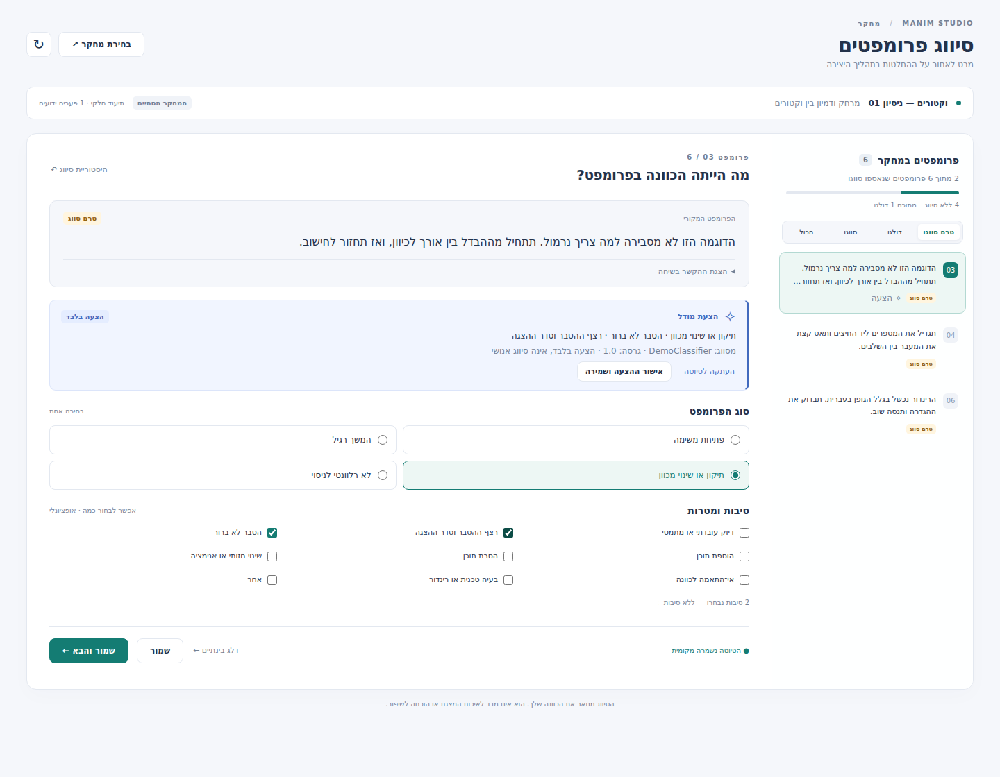
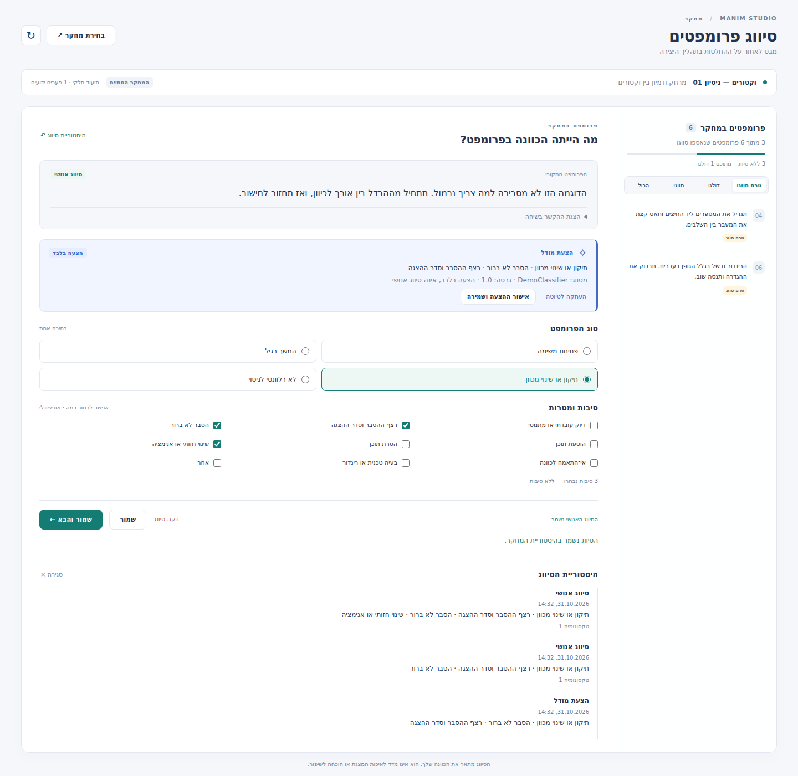
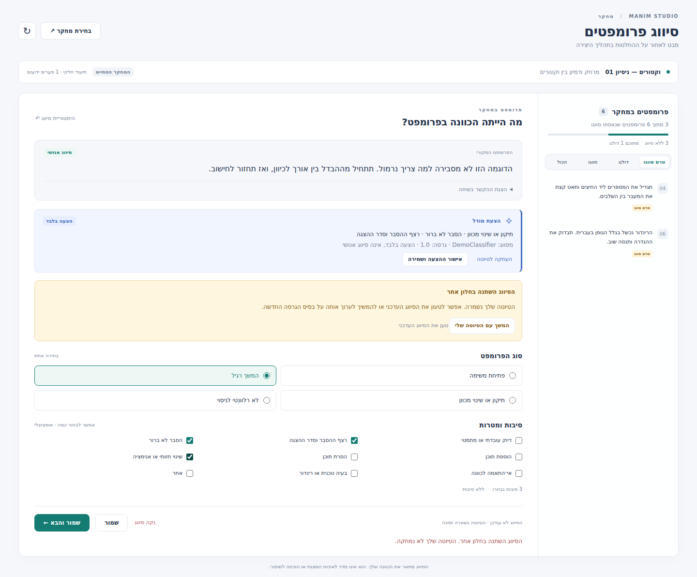

# Prompt classification UI

Implemented locally on `research/prompt-logging`, following the [design](../design/prompt-classification-ui-he.md). Native Windows VS Code acceptance remains open. No automatic classifier is included.

## Open and use

Compile the extension with `npm run compile --prefix vscode-extension` and launch the extension development host using the repository's existing VS Code workflow. Use an installed Studio executable from this checkout, because the extension now calls `studio research rpc --repo-root PROJECT` for annotations.

Run **Manim Studio Research: Classify Prompts** from the command palette, or choose **Classify prompts** in the research session menu. Select a research session. The panel keeps that selection until explicitly changed, independently of the authoring session.

The panel lists captured prompts with filters, coverage warnings and counts. Read the original prompt and linked context, select one primary type, then optional reasons. Selecting “other” requires text. Unspecified reasons remain null; the “no reasons” action records an explicitly reviewed empty list.

Save, save-and-next, revise and clear preserve the append-only history. Skip records a deferral and does not count as an irrelevant prompt or as completed annotation. Existing model suggestions appear separately and never automatically fill or confirm human choices. They may be copied into a draft or explicitly approved.

Drafts are stored in VS Code workspace state. An interrupted save retains its exact request ID and payload for retry. Concurrent edits produce a conflict with the draft preserved; explicitly choose the latest annotation or rebase the draft before saving. A crash before draft persistence may lose the last keystrokes. Storage failure is not reported as a successful save.

Annotations remain possible for paused or finished research and with capture disabled. Annotation RPC runs in a separate process from authoring RPC; classification does not require a model call.

## Versioned API

CLI and MCP expose `classification.schema`, `classification.list`, `classification.get`, `classification.history`, `classification.save`, `classification.skip`, `classification.clear` and `classification.suggest`.

Read `classification.get` with session/prompt IDs first. For save, supply the returned project ID and current human head:

```json
{
  "project_id": "PROJECT_ID",
  "session_id": "SESSION_ID",
  "prompt_id": "PROMPT_ID",
  "request_id": "NEW_UNIQUE_REQUEST_ID",
  "expected_human_head": null,
  "prompt_type": "corrective",
  "reasons": ["unclear_explanation"],
  "taxonomy_version": 1
}
```

Use explicit null only when the returned head is null. Subsequent writes copy the returned head event ID. Retry the identical request after an unknown outcome; use a new request ID for a different decision. The old human `classify` bridge also requires request ID and expected head; old unversioned human writes now fail explicitly. Model suggestions never advance the human head. Database schema v4 remains additive; existing events are readable.

## Validation on 31 October 2026

| Check | Result |
|---|---|
| Python research, capture, MCP, sessions, CLI and Windows font regression suites | 152 passed locally on Linux |
| TypeScript compilation and extension test scripts | Compile + 8 scripts passed |
| Exact webview/controller with real Python RPC in Chromium | 10 scenarios passed |
| Native VS Code on clean Windows, installed package and actual Codex delivery | Not run here; manual acceptance remains open |

Backend tests include concurrent writers, receipts after head changes, null/empty reasons, invalid taxonomy, cross-project/session isolation, legacy history, capture disabled, bounded database lock failure, real MCP stdio, transactional rollback and process termination before/after commit. Extension tests include the dedicated transport, bundled media availability, pinned session, pending retries and unchanged request IDs.

Browser scenarios cover model suggestion separation, draft restoration, save, correction/history, concurrent edit conflict, a lost response after commit with a single resulting event, clear/history retention, skip semantics, explicit empty reasons and real authoring RPC while an annotation response is held. The VS Code hosting API is simulated for this browser harness; the panel/controller and annotation backend are the implementation under test. This does not establish native extension-host acceptance.

Reproduce the backend command from the repository root:

```bash
PYTHONPATH=src python -m pytest tests/test_prompt_classifications.py tests/test_research_sessions.py tests/test_research.py tests/test_research_capture.py tests/test_research_capture_acceptance.py tests/test_manim_mcp_services.py tests/test_authoring_sessions.py tests/test_studio_cli.py tests/test_windows_fonts.py -q
npm test --prefix vscode-extension
```

The optional browser harness requires Playwright available to Node and a Chromium executable; neither is a product runtime dependency:

```bash
CHROMIUM_EXECUTABLE=/path/to/chromium node scripts/test-classification-ui.js
```

It creates an isolated temporary database with synthetic Hebrew data and makes no model calls. Results are in `validation/classification-tests.txt`, `validation/classification-extension.txt` and `validation/classification-browser.txt`.

## Screenshots

These are actual renders of the extension webview in Chromium with synthetic fixture data, not screenshots of a native VS Code window. The browser harness regenerates them.







For native acceptance, install the updated package in clean Windows VS Code, capture a real conversation, classify and correct prompts, reload with a draft, verify concurrent-window conflict handling, and continue authoring while the classification panel is open. Check exported history against the human decisions. Until that passes, the feature is implemented and locally validated but not fully closed for the experiment.
