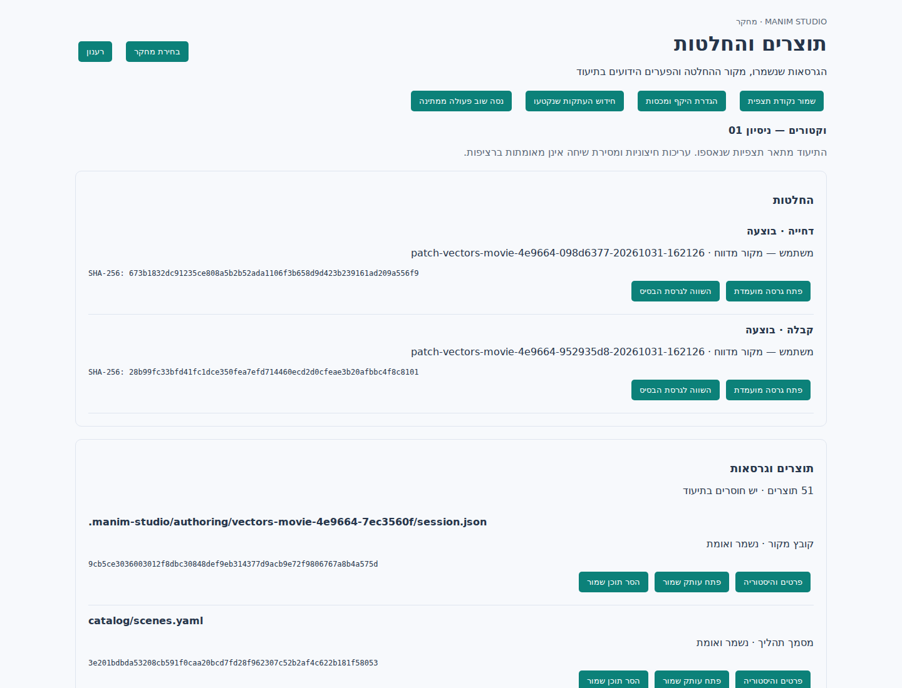

# Research artifacts and decisions

Feature 4 is implemented locally against the [design](../design/research-artifacts-decisions-he.md). Native Windows VS Code acceptance is still open. This feature does not implement the timers or the scoped ZIP export planned in features 5–6.

## Use in VS Code

Open the configured project and run **Manim Studio Research: Show Artifacts and Decisions** from the command palette, or select **Artifacts and decisions** from the research menu. Choose a research session. Its selection remains pinned independently of changes in the authoring window or research status bar.

The panel shows decisions with their reported origin and outcome, retained artifacts, omission reasons, and source snapshots. You can open retained source without changing working files, compare a decision's candidate with its baseline, inspect history, capture an explicit checkpoint, configure capture scope/quotas, and explicitly purge retained content. Purge preserves historical events and does not delete another artifact's shared content reference.

**Configure Capture Scope** supports session settings or project defaults. The dialog previews the selected files before saving. Root `lesson-plan*.md` and `storyboard*.md` join the existing catalog, scene, deck and authoring source scope. Additional MD/YAML/JSON/Python files or directories must be selected explicitly. `research-inputs/` is not collected until selected. Credentials, `.env`, virtual environments, Git data, Codex configuration and the research ledger are excluded. Paths must remain inside the project; symlinks and Windows reparse points are refused.

Source reads are bounded to 1 MB per file, 10 MB and 500 files per checkpoint, with a separate discovery limit. Default retained-content budgets are 2 GiB per session and 10 GiB per project. A session override cannot bypass the project quota. Video/final-product files are limited to 100 MiB, logs and supporting render evidence to 5 MiB. Oversized, missing, changed or over-quota content receives an explicit unavailable reason. Previously retained content is not silently evicted.

## What is observed

Managed research creation captures an initial checkpoint. Instrumented authoring operations capture source observations; accept/reject/revise capture candidate and baseline evidence around the core transition. Polling read methods do not generate a new archived checkpoint on every status refresh. Checkpoints detect changed or missing content between observations, without inventing an editor, prompt, or exact edit time. Changes created and removed entirely between observations can remain unobserved.

Core transition hooks cover controller, movie-session and staged-edit paths, so nested service/RPC calls produce one decision observation. The transition captures the prepared candidate, validates its identity before apply/reject, and uses an OS-released cross-process lock for competing research-observed decisions. A failed render remains a failed decision; interruption across a capture boundary remains outcome unknown. The archive does not supply transactional rollback of external authoring changes or merge concurrent editing.

Explicit VS Code commands report human origin; MCP calls report automation; missing provenance stays unknown. This is caller-reported evidence, not authentication of human intent. A stable optional `_research.request_id` can return a completed decision's original result without executing it again; a recorded unknown outcome is not automatically replayed. Research storage failures warn and leave authoring operational, so durable evidence is not guaranteed during storage failure.

Render/build/export outputs enqueue durable retention jobs from immutable build directories. The worker validates the observed file identity, size and timestamps before/after reading, computes a content SHA-256, and publishes the file before committing a retained reference. Changed sources become unavailable rather than being substituted for the original observation. The queue is bounded; interrupted leases become eligible for retry after 120 seconds. Opening the panel/status or explicit retry can restart an eligible worker. Large-file copying is separate from the authoring RPC queue. Source checkpoints are synchronous and bounded.

The live preview reports `loadedmetadata` with its original build and research identity. Generated video alone is never recorded as presented. If the archived bytes and source identity are already verified, the event links the reported open to that SHA. Otherwise the client report is explicitly `artifact.presentation_unverified`. Opening a retained artifact from the archive separately records its SHA while collection is active. None of these events proves that a person watched an entire video or read an entire document.

Paused/finished/capture-off sessions remain readable. Explicit new checkpoints and presentation observations require active collection. Jobs may finish retaining an already observed immutable build after pause, but a result produced across an off/on collection boundary is not backfilled. A resumed snapshot describes current content, including surviving edits whose creation time may be unknown.

## Storage, APIs and compatibility

SQLite schema v5 adds policy, artifact, snapshot, job and decision projections. Migration checks future schema versions before writing, takes a SQLite API backup under the migration writer lock, closes the backup before publishing it, and commits DDL/version changes atomically. A failed migration retains the old version. Backups are stored alongside the ledger as `migration-backup-*.sqlite3`.

Archived bytes are deduplicated under `.manim-studio/research/artifacts/sha256/`. Binary viewer references preserve the file extension through validated hard links; explicit purge removes these references as well when possible. Source opens use independent editor documents. The research directory is excluded when copying staged proposal workspaces.

CLI and MCP use the same `artifacts.*` service as the dedicated research RPC. Read operations: `list`, `get`, `history`, `policy`, `preview_scope`, `job_status`, `content`. Mutations: `checkpoint`, `configure`, `purge`, `presented`, `presented_build`, `retry_jobs`. Supply `session_id`, a unique `request_id` for each mutation, and the applicable expected revision for configure/purge. A supplied project ID must match. Repeat an uncertain mutation with its identical original request. A changed payload with the same ID fails.

For example, provide this JSON on stdin to `python -m manim_studio.research_cli --root PROJECT artifacts.checkpoint`:

```json
{"session_id":"RESEARCH_SESSION_ID","request_id":"NEW_UNIQUE_REQUEST_ID"}
```

List pagination uses `offset` and `limit` (maximum 100). Session settings use their own policy revision; project defaults use `project_revision` from `artifacts.policy`. The panel retains uncertain mutations in workspace state and blocks switching their target until resolved.

The legacy full JSONL export includes retained source/candidate/planning/log bytes as `source.blob`, while metadata export excludes raw text. Large video/final products remain in the local archive; portable media packaging, an integrity report and scoped atomic export are feature 6. Existing legacy SQLite blobs are not purged merely because a newer archive reference was purged. Retention quotas account for archived referenced content, not every byte of SQLite history, indexes, migration backups or temporary/orphan files. Storage maintenance and the unified integrity report remain feature 6.

## Validation on 31 October 2026

| Check | Result |
| --- | --- |
| Python research/capture/classification/artifacts/MCP/authoring/CLI/font regression suites | 180 passed locally on Linux; 28 new artifact tests |
| Additional build, staged-edit and movie-session regression suites | 25 passed locally on Linux (205 Python tests in total) |
| TypeScript and extension behavior | Compile and 9 test scripts passed |
| Exact artifacts webview/controller with real Python RPC in Chromium | 8 scenarios passed; VS Code hosting API simulated |
| PowerShell setup regression and all-script parsing | Passed with PowerShell 7 on Linux |
| VSIX payload | Built locally and checked for commands, compiled modules and both panels' media assets |
| Native Windows extension host, clean installation and actual client delivery | Not run here; remains an acceptance gate |

New service tests cover source revisions/deletion, policy preview and CAS, quotas, cross-session/project rejection, paused/off capture, shared-content purge, corrupt bytes, worker retention after build cleanup, missing/changed build sources, receipts across RPC restart, real process termination after publish/before database commit, expired worker leases, schema backup/rollback/future-version rejection, nested decisions, candidate changes during rendering, original authoring exception/result preservation, off/on capture boundaries, and reported presentation versus generated/retained content.

Reproduce the artifact tests and UI test after compiling the extension:

```bash
PYTHONPATH=src python -m pytest tests/test_research_artifacts.py -q
npm test --prefix vscode-extension
CHROMIUM_EXECUTABLE=/path/to/chromium node scripts/test-artifacts-ui.js
```

The optional browser harness requires Playwright available to Node. It creates only a temporary synthetic project, calls no model, and cleans it up. Logs: `validation/artifacts-tests.txt`, `artifacts-tests.xml`, `artifacts-extension.txt`, `artifacts-browser.txt`, `artifacts-powershell.txt`, `artifacts-vsix.txt` and `artifacts-authoring-regressions.txt`.



The screenshot shows the implemented webview in Chromium, not native VS Code. For Windows acceptance: capture a real research session; reject and accept different candidates; inspect their stored source and diff; open a retained video after deleting its original build; reload an uncertain checkpoint; verify quota and paused states; and confirm the live-preview presentation report is attributed to its original research. Only after that should feature 4 be marked fully closed.
