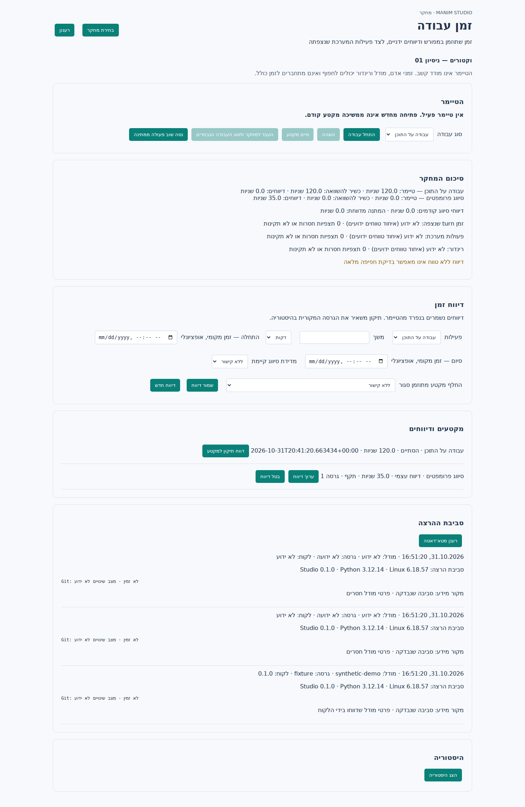

# זמן עבודה ומטא־דאטה של הרצה

פיצ׳ר 5 מומש לפי [הדיזיין](../design/research-time-metadata-he.md). המימוש נבדק מקומית; קבלה בתוך VS Code ב־Windows נשארת פתוחה.

## שימוש במסך

ב־VS Code, אחרי פתיחת תיקיית הפרויקט ומתן אמון בה, מפעילים מלוח הפקודות (`Ctrl+Shift+P`) את **Manim Studio Research: Human Time and Run Metadata**. אפשר להגיע גם מתפריט המחקר.

1. בוחרים מחקר וסוג עבודה: עבודה על התוכן או סיווג פרומפטים. לוחצים **התחל עבודה**.
2. **השהה** ו־**סיים מקטע** סוגרים את המקטע. התחלה נוספת יוצרת מקטע חדש.
3. בדיווח ידני מזינים דקות או שניות. אפשר לציין טווח זמנים, מדידת סיווג קודמת או מקטע סגור שהדיווח מחליף.
4. **ערוך דיווח**, **בטל דיווח** ו־**דווח תיקון למקטע** משאירים את ההיסטוריה המקורית קריאה. דיווח בדיעבד אפשרי גם לאחר סיום המחקר או כיבוי האיסוף.
5. **רענן מטא־דאטה** מתעד סביבת הרצה נוכחית. פרטי מודל שלא התקבלו מהלקוח נשארים לא ידועים.

בחירת מחקר אחר משנה את התצוגה בלבד; העברת הטיימר דורשת פעולה מפורשת. סרגל המצב מציג את שם מחקר הטיימר, סוג העבודה והשניות המאושרות. סגירת מסך הזמן אינה מפסיקה טיימר כל עוד התוסף פעיל; פתיחת התוסף מחדש אינה מחדשת אותו אוטומטית.

טיוטות נשמרות מקומית לפי מחקר. בקשה שתשובתה אבדה נשמרת לניסיון חוזר עם אותו מזהה ואותם פרמטרים. כתיבה חדשה בזמן שמירה אינה נמחקת בעקבות תשובה ישנה. אישורי טיימר נשמרים בנפרד מבקשה ידנית ממתינה, כדי שהמתנה לניסיון חוזר לא תעצור את האישורים התקופתיים.



הצילום והבדיקה משתמשים במעטפת VS Code מדומה ובשירות Python אמיתי. הם אינם בדיקת קבלה של תוסף Windows.

## מדידה והתאוששות

SQLite v6 אוכף טיימר פעיל יחיד למשתתף בפרויקט, כולל חלונות ומחקרים שונים. transfer סוגר ופותח מקטע באותה טרנזקציה. אין נעילה חוצת מחשבים או פרויקטים.

תהליך Python ייעודי מחזיק את השעון המונוטוני. heartbeat מתוכנן כל 15 שניות, עם sequence וקבלה עמידה; ניסיון חוזר אינו מוסיף זמן פעמיים. lease של 45 שניות, החלפת תהליך או פער suspend מפסיקים צבירה ושומרים רק checkpoints מאושרים. הזנב שלא אושר מסומן כלא ידוע. תהליך חדש אינו משתמש בערך המונוטוני של תהליך קודם ואינו מחדש טיימר בעצמו.

השהיית מחקר, סיומו וכיבוי האיסוף סוגרים את הטיימר באותה טרנזקציית ניהול. אם השעון הבעלים אינו נגיש, נשמר האישור האחרון והסגירה מסומנת interrupted. קריאת סטטוס מחלון אחר אינה עוצרת בעלים חי שה־lease שלו עדיין בתוקף; אפשר לעצור או להעביר במפורש.

UTC אינו משמש להמצאת משך עבודה. קפיצת שעון מסומנת; משך מונוטוני תקף נשמר במקור אך מקטע עם clock anomaly אינו נכנס לסכום שכשיר להשוואה. טווח מחקר בעל גבולות הפוכים אינו הופך למשך שלילי.

## פירוש הסיכומים

`aggregation_version=1` מפריד בין משפחות מדידה שאסור לחבר לזמן כולל:

| שדה | משמעות |
| --- | --- |
| `tracked_seconds` | checkpoints מאושרים לפי עבודה וסיווג, ללא מקטע שהוחלף בדיווח מפורש |
| `canonical_tracked_seconds` | אותו סיכום ללא clock anomaly; חפיפה בין מקטעים הופכת את הסכום ללא ידוע |
| `self_reported_seconds` | דיווחים תקפים לפי עבודה, סיווג והמתנה; אינם מתווספים לטיימר |
| `legacy_classification_self_report_seconds` | זמן מסיווג קודם, ללא מדידה שהוחלפה בדיווח עם אותו `measurement_ref` |
| `system.tool` / `system.render` | סכומי משכים ואיחוד טווחים בכל משפחה בנפרד; גבולות חסרים או לא תקינים מסומנים |
| `system.model_turn` | איחוד גבולות turn שנצפו, לפי לקוח/thread/turn; אינו זמן GPU |
| `research_wall_seconds` | טווח התחלה–סיום תקף של המחקר; אינו זמן עבודה אנושי |

דיווח בלי טווח, חפיפות וזנב לא מאושר מוצגים כאזהרות. replacement דורש מקטע סגור באותו מחקר וקטגוריה ובדיקת revision. מדידת סיווג מקושרת חייבת להשתייך לאותו מחקר. שני דיווחים תקפים לאותו קישור נדחים. ביטול דיווח מחזיר את מדידת המקור לסיכום. אין הסקת זמן אנושי מהמרווח בין הודעות או מפוקוס החלון.

## מטא־דאטה ואחסון

הקשר הרצה כולל Studio, Python, OS, חבילות, גרסאות schema ו־taxonomy, commit ומצב שינויים ב־Git, גרסת תוסף זמינה, מודל והגדרות שדווחו. נשמרים מקור המידע וזמן התצפית. הקשר נוצר בתחילת מחקר, בחיבור לקוח, בתחילת מקטע וברענון מפורש; שינוי מודל יוצר הקשר חדש ואינו משייך מחדש אירועי עבר. אין ירושת מודל מלקוח אחר. נתון לא זמין נשאר null.

Git נבדק מקומית עם timeout. אין קריאה למודל או איסוף משתני סביבה. רשימות שדות מותרות מסננות מודל והגדרות לפני כתיבת אירועים חדשים ובייצוא מטא־דאטה. תוכן שיחה מלא נשאר תוכן שנאסף במפורש ואינו מטא־דאטה מסונן.

שדרוג v6 מגובה וטרנזקציוני ואינו ממציא זמן לנתונים ישנים. אירועים, תיקונים וקבלות נשמרים לצד projections. JSONL הקיים כולל אירועי זמן והקשרי הרצה; ייצוא אטומי למחקר ודוח שלמות הם פיצ׳ר 6.

API משותף ל־CLI, MCP ו־RPC: `timing.status/history/contexts/start/pause/stop/transfer/heartbeat/report/correct/void/observe_context`. קריאות דורשות session; שינויים דורשים request ID ו־scope מאומת. start/stop/transfer משתמשים ב־revision של מצב הטיימר, heartbeat ב־interval וב־sequence, תיקון דיווח ב־revision שלו, ו־replacement גם ב־revision המקטע. ניסיון חוזר משתמש באותה בקשה בדיוק. השעון דורש תהליך RPC מתמשך; פקודות CLI נפרדות אינן בעלים רציף של טיימר. בשימוש רגיל מפעילים דרך מסך VS Code.

## בדיקות ותנאי קבלה

| בדיקה | תוצאה מקומית |
| --- | --- |
| 14 מודולי Python של מחקר, capture, סיווג, תוצרים, MCP, יצירה, CLI וגופנים | 237 עברו; 31 חדשות לזמן ומטא־דאטה |
| TypeScript והתנהגות התוסף | קומפילציה ו־10 סקריפטי בדיקה עברו |
| המסך והשירות האמיתי ב־Chromium | 9 תרחישים עברו; מעטפת VS Code מדומה |
| PowerShell 7 על Linux | parsing ורגרסיות התקנה עברו |
| VSIX | נבנה ונבדקו פקודה, controller וכל נכסי הזמן |
| תוסף בפועל והתקנה נקייה ב־Windows | פתוח עבור השינויים החדשים |

בדיקות השירות כוללות שעון מבוקר, תחרות בין חלונות, transfer אטומי, retry, מוות של תהליך לפני commit ואחריו ללא תשובה, החלפת בעלים, sleep, UTC הפוך, CAS, השהיה/סיום/כיבוי, rollback בכשל כתיבה, דיווח/תיקון/ביטול, מניעת כפל עם סיווג, חפיפות, קישורים שגויים, Unicode ב־RPC בסביבת CP1252, migration מ־v5, Git חסר/dirty/timeout, סינון מידע והקשר מודל בלתי משתנה. בדיקות התוסף כוללות טיוטה חדשה בזמן שמירה, heartbeat לצד דיווח לא מאושר, ושחזור שאינו מחדש מדידה.

```bash
PYTHONPATH=src python -m pytest tests/test_research_time.py -q
npm test --prefix vscode-extension
CHROMIUM_EXECUTABLE=/path/to/chromium node scripts/test-time-ui.js
```

ה־harness דורש Playwright הזמין ל־Node, יוצר פרויקט זמני וסינתטי ואינו קורא למודל. תוצאות נשמרות ב־`validation/time-tests.txt`, `time-tests.xml`, `time-extension.txt`, `time-browser.txt`, `time-powershell.txt` ו־`time-vsix.txt`. בדיקות הזמן נוספו ל־Windows CI ובדיקת החבילה דורשת את הפקודה ונכסיה.

לפני סגירה מלאה ב־Windows: לבדוק עבודה וסיווג, שני חלונות, השהיה וסיום מחקר, כיבוי איסוף ודיווח בדיעבד, reload עם טיימר וטיוטה, ניתוק וסגירה בכוח. לוודא שהזנב הלא מאושר מסומן ושטיימר אינו מתחדש מעצמו. מעבר הבדיקות המקומיות אינו מחליף קבלה זו.
